<!-- Every card is an animated SVG drawn by scripts/render_readme_cards.py and refreshed daily
     by .github/workflows/profile-cards.yml. Shapes and spacing are matched to the reference
     profile design; the palette is therayyanawaz.co.in. Spacing is baked into the SVGs, so
     keep this block free of blank lines and keep the cards in a row on one line. -->

 
 
 
 
<picture><source media="(prefers-color-scheme: dark)" srcset="./cards/title-coding-dark.svg" /></picture> 

<a href="https://therayyanawaz.co.in">therayyanawaz.co.in</a> &nbsp;/&nbsp; <a href="https://linkedin.com/in/therayyanawaz">linkedin</a> &nbsp;/&nbsp; <a href="https://instagram.com/therayyanawaz">instagram</a> &nbsp;/&nbsp; <a href="https://mail.google.com/mail/?view=cm&amp;fs=1&amp;to=therayyanawaz@gmail.com">email</a>

